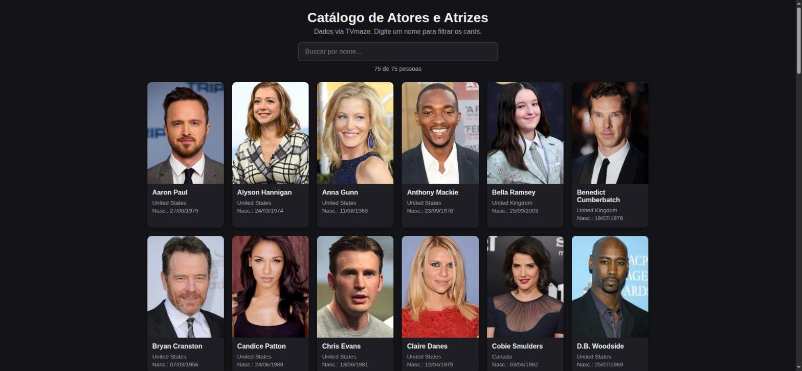
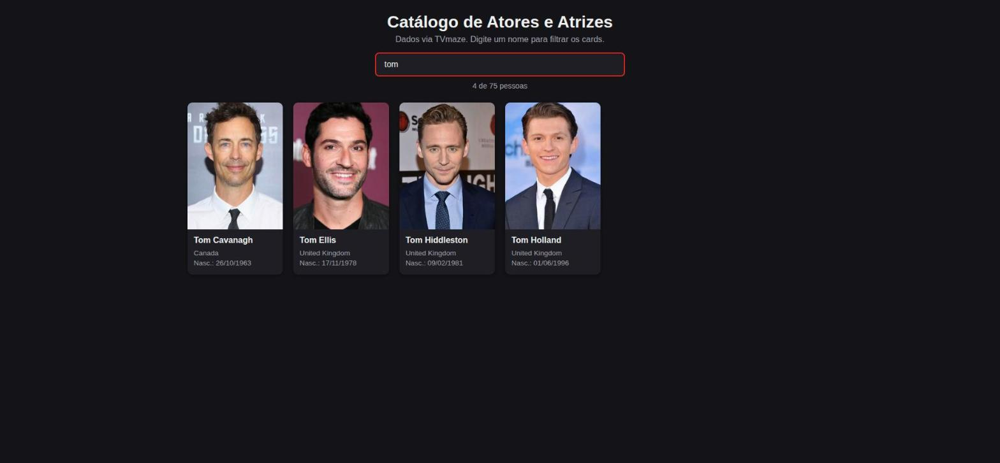

# CheckPoint 2 – Application Development

Catálogo de atores e atrizes em HTML/CSS/JavaScript puro.

- Renderiza os 75 registros de `dados.js` em um grid de cards (foto, nome, país, data de nascimento).
- Campo de busca filtra os cards pelo nome enquanto o usuário digita (`oninput`, `filter()`, `includes()`).

## Como rodar

Abrir `index.html` no navegador.

## Snapshots

| Tela ao abrir | Filtro aplicado ("tom") |
|---|---|
|  |  |
